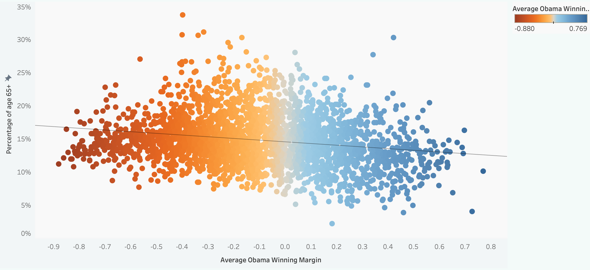
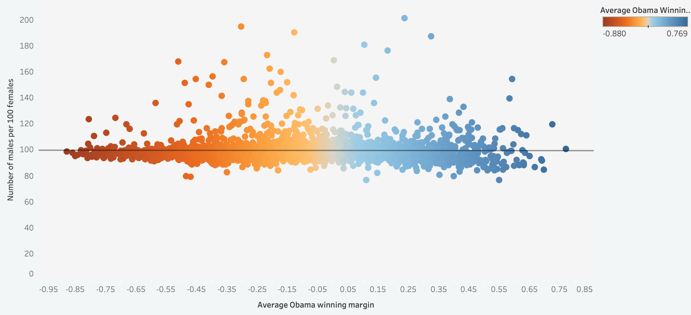
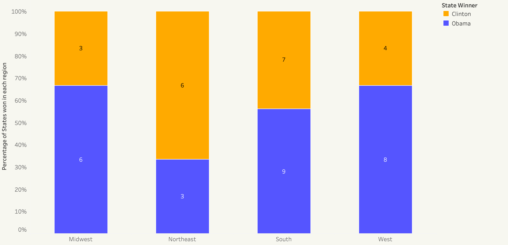
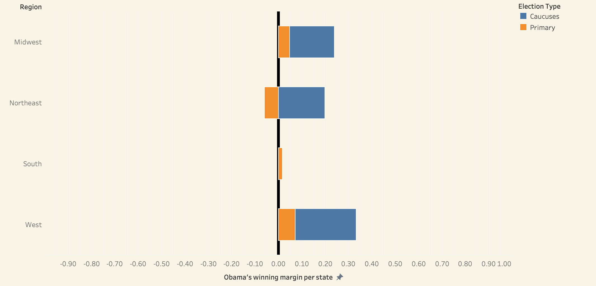
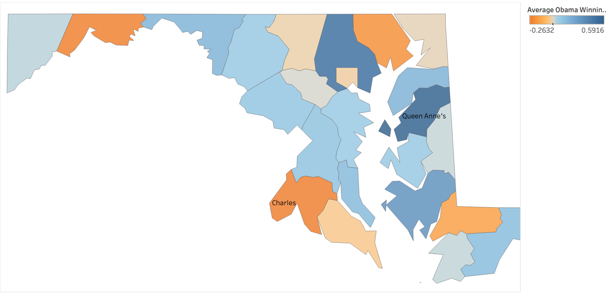
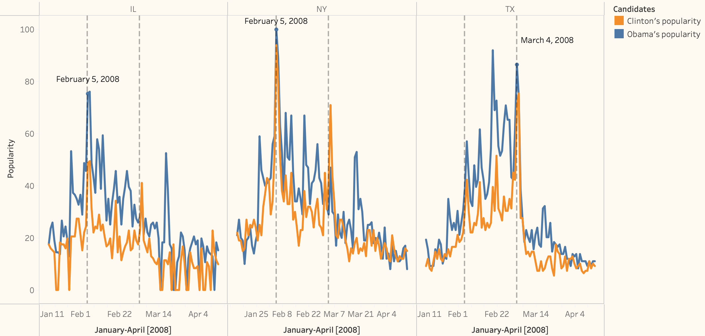
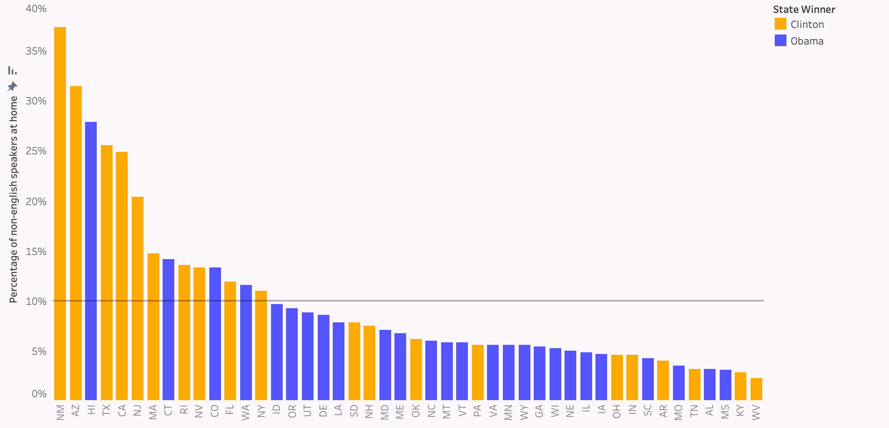

# Demographic and Geographic Analysis of the 2008 Democratic Primaries

An exploratory Tableau analysis of how demographics, geography and election format related to support for Barack Obama and Hillary Clinton in the 2008 Democratic primaries, from the county level up to regions of the country.

Individual coursework for the MS in Business Analytics and AI at the University of Maryland, Robert H. Smith School of Business.

**My contribution:** the full analysis and all seven visualizations, built in Tableau, including the written interpretation of each chart.

## Questions

1. Do age and gender balance help explain Obama's winning margin across counties?
2. How did results differ by region and by election format (primary versus caucus)?
3. What does the pattern look like at the county level inside one state, Maryland?
4. How did public interest in each candidate move around election day in Illinois, New York and Texas?
5. Is the share of non-English speakers at home related to which candidate won a state?

## Key findings

- **Age and gender:** counties with older populations showed slightly lower support for Obama, but the relationship is weak. Gender balance showed no clear relationship.
- **Regions:** Obama won more states than Clinton in the Midwest, South and West. Clinton won the majority of Northeast states.
- **Election format:** Obama's average margin was larger in caucuses than in primaries in every region that held both. In the Northeast he lost the primaries but won the caucuses.
- **Maryland:** Obama won most counties. His margin was highest in Queen Anne's County and lowest in Charles County.
- **Timing:** interest in both candidates rose gradually, climbed sharply in the final week, peaked on election day and then fell back quickly.
- **Language:** Clinton tended to win states with a higher share of non-English speakers at home, and Obama tended to win states with a lower share.

## Analysis

### 1. Age and Obama's winning margin, by county

Obama's average winning margin shows a slight negative relationship with the share of residents aged 65 and over. Counties with older populations tend to show lower support for Obama. The wide spread of points shows that the relationship is weak, so age alone is not a strong predictor of the outcome.

### 2. Gender balance and Obama's winning margin, by county

There is no clear relationship between gender balance, measured as males per 100 females, and Obama's winning margin per county. The points are scattered without an obvious trend, so gender balance does not appear to influence the outcome.

### 3. States won by each candidate, by region

Obama won more states than Clinton in every region except the Northeast, where Clinton won the majority of states.

### 4. Average winning margin, by region and election type

Obama's winning margin was larger in caucuses than in primaries in every region except the South, where only primaries were held. In the Northeast, Obama lost the primaries but won the caucuses.

### 5. Obama's winning margin across Maryland counties

Obama outperformed Clinton and won the majority of Maryland counties. His margin was highest in Queen Anne's County and lowest in Charles County.

### 6. Daily popularity of each candidate in Illinois, New York and Texas

Obama's popularity was higher than Clinton's for most of the period in all three states. Illinois shows a clear Obama lead, Texas was moderately competitive, and New York was the closest, with the smallest gap on election day. On the election days in all three states, Obama's popularity was higher than Clinton's.

Both candidates follow a similar pattern: popularity rises gradually with fluctuations, climbs sharply in the final week, peaks on election day and then falls quickly to its earlier level. This suggests that a campaign could concentrate advertising and outreach in the final week, when voters are most engaged.

Popularity is a daily index scaled from 0 to 100.

### 7. Non-English speakers at home and the state winner

Clinton tended to win states with higher shares of non-English speakers at home, particularly in the 10% to 38% range, while Obama tended to win states below 10%. This suggests a relationship between linguistic diversity and the result. From a campaign perspective, it shows where each candidate was stronger: Obama's campaign could have invested more in outreach to linguistically diverse states to close the gap, while Clinton's campaign could have invested more in states with few non-English speakers.

## Built with

Tableau (scatter plots with trend lines, stacked and grouped bar charts, filled map, time series with reference lines).

## Limits

- All data is aggregated to counties and states. The charts describe patterns across places, not the behavior of individual voters, so they should not be read as claims about individuals.
- The analysis is exploratory. It shows relationships and comparisons but does not fit a predictive model or test causes.
- State level comparisons use a small number of observations per region.

## Data

County and state level results of the 2008 Democratic primaries, joined with demographic data (age structure, gender balance and language spoken at home) and a daily popularity index for Illinois, New York and Texas from January to April 2008.

[Add the data source and license here before publishing.]
